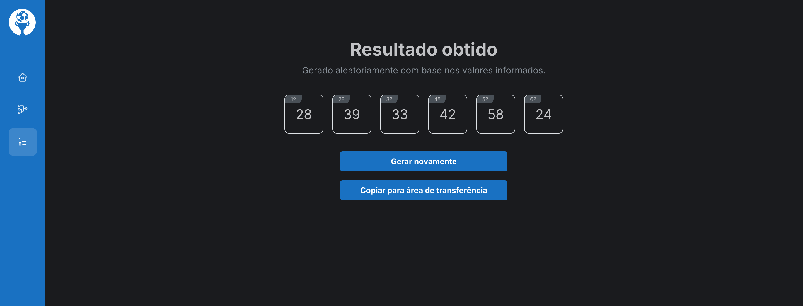
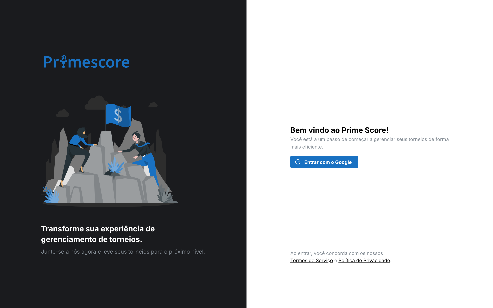
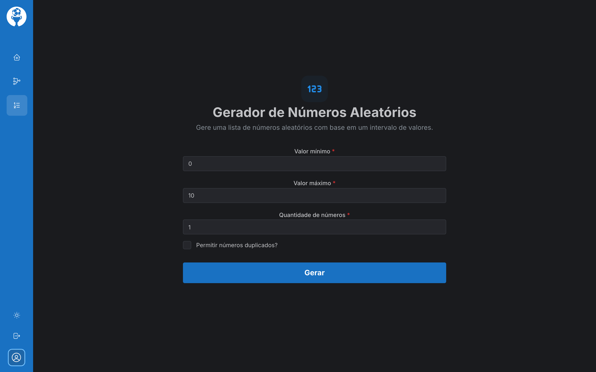
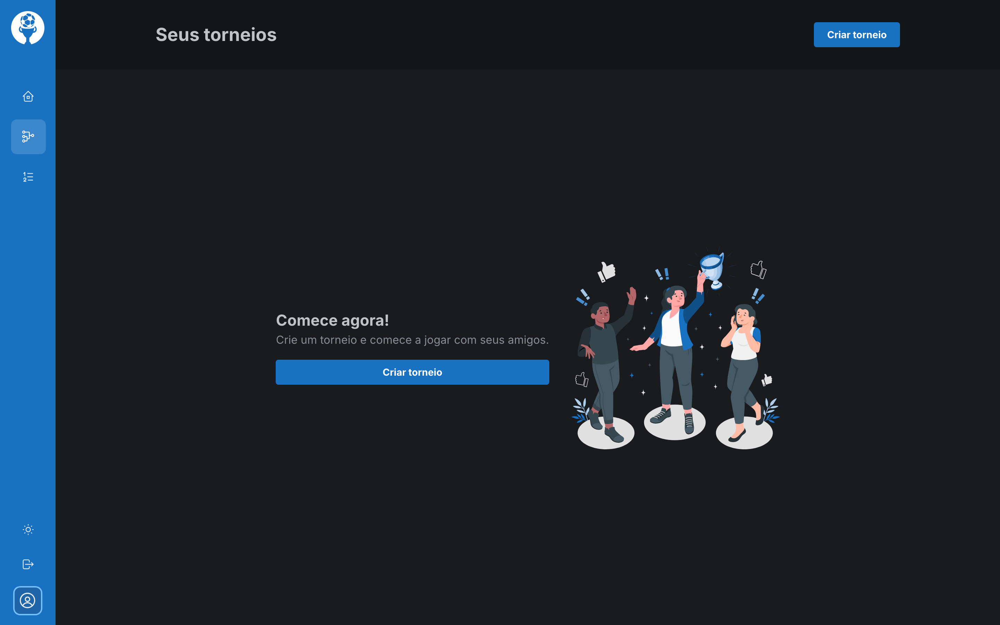
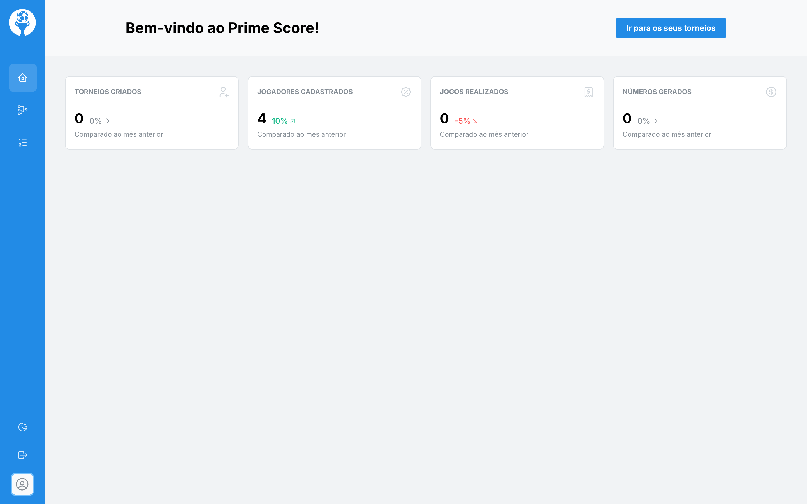
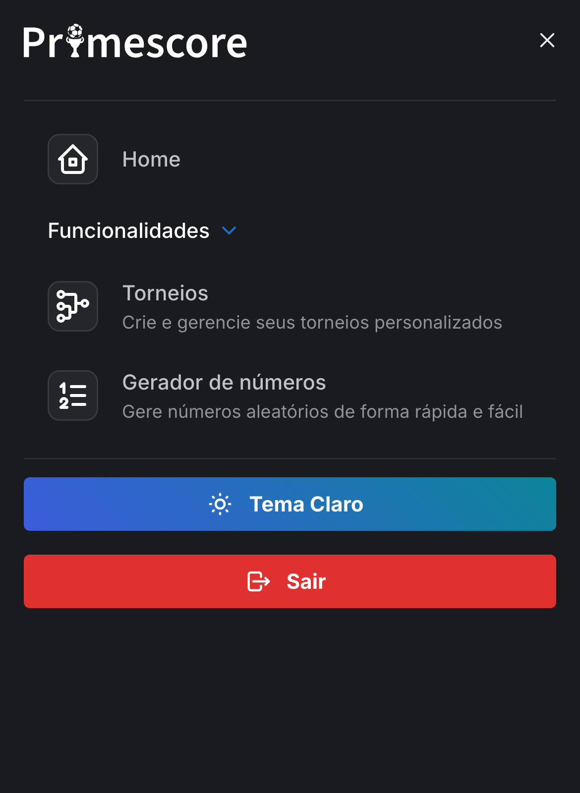
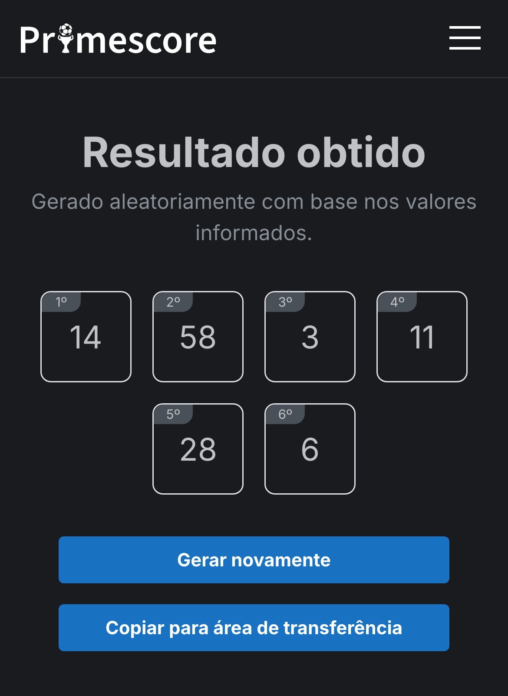
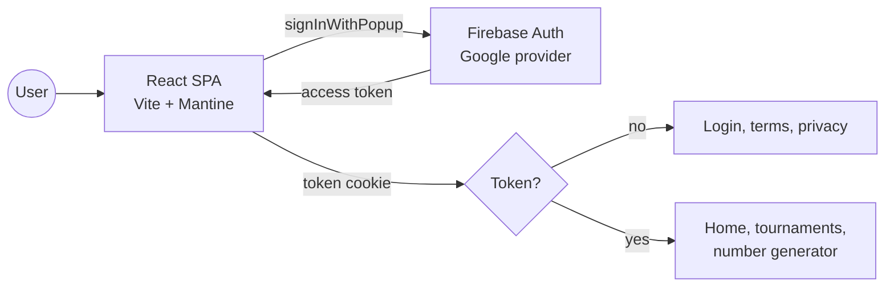

<div align="center">

<picture>
  <source media="(prefers-color-scheme: dark)" srcset="src/assets/logo/logo-extend-white.svg" />
  
</picture>

<br />
<br />

**A tournament manager that stopped at its first screens: Google sign-in, the app shell and a random number generator.**


[Features](#features) •
[Screenshots](#screenshots) •
[How it works](#how-it-works) •
[Tech stack](#tech-stack) •
[Running locally](#running-locally) •
[History](#project-history)

</div>

> [!WARNING]
> **Discontinued.** Prime Score is no longer maintained and this repository is archived as a portfolio reference. The tournament features were never built, there is no live demo, and the `@quantun/*` packages it depends on are no longer on npm (see [Running locally](#running-locally)).



## About

Prime Score was meant to be a web app for running amateur championships: create a tournament, add teams, players and matches, then follow results and standings as games are played. I started it in March 2023 and worked on it for about six weeks.

The tournament part never got past an empty state. What did ship is the groundwork around it (Google sign-in, a responsive layout, themes, legal pages, PWA support, tests) and one complete tool: a random number generator for draws.

It was also the first app built on [quantun](https://github.com/RanielliMontagna/quantun), the component library I maintained at the time. Its sidebar, mobile app bar and login screen template were extracted while building Prime Score. The interface is in Portuguese.

## Features

- **Google sign-in** with Firebase Authentication. The session token is kept in a cookie for seven days, and the router switches between public and private routes based on it.
- **Random number generator**: pick a minimum, a maximum (up to 1,000) and how many numbers to draw, with or without repeats. Results are numbered in draw order and can be copied to the clipboard.
- **Tournaments page**: only the empty state and a "Criar torneio" (create tournament) button, which does nothing yet.
- **Home**: four stat cards (tournaments, players, games, numbers drawn) with placeholder values.
- **Responsive layout**: a collapsible sidebar on desktop and an app bar with a drawer on mobile, both from `@quantun/core`.
- **Dark and light themes**, saved in `localStorage`.
- **Terms of service and privacy policy** pages, reachable signed in or out, plus a 404 page.
- **Installable PWA** with `vite-plugin-pwa` and automatic updates.
- **Unit tests** with Vitest and Testing Library.

## Screenshots

<table>
  <tr>
    <td width="50%"><p align="center"><sub>Sign-in with Google</sub></p></td>
    <td width="50%"><p align="center"><sub>Number generator</sub></p></td>
  </tr>
  <tr>
    <td width="50%"><p align="center"><sub>Tournaments, never past the empty state</sub></p></td>
    <td width="50%"><p align="center"><sub>Home with placeholder stats, light theme</sub></p></td>
  </tr>
</table>

<p align="center">
  
  &nbsp;&nbsp;
  
  <br />
  <sub>Mobile navigation and a draw on a phone</sub>
</p>

## How it works

It is a client-only single-page app. There is no backend: Firebase handles sign-in and nothing is stored server-side.



```text
src/
├── components/   # header, sidebar, mobile app bar, loading overlay
├── containers/   # one folder per page (login, home, torneios, geradorNumeros, termos, ...)
├── layouts/      # public and private layouts
├── libs/         # Firebase initialisation
├── routes/       # route table, split by sign-in state
├── store/        # Zustand stores for auth and app state (loading, theme)
└── test/         # Vitest setup and shared mocks
```

## Tech stack

| Area | Tools |
| --- | --- |
| UI | React 18, TypeScript, Mantine 6, Emotion, Tabler Icons, `@quantun/core`, `@quantun/login-screen` |
| State and routing | Zustand, React Router 6 |
| Auth | Firebase Authentication (Google) |
| Utilities | random-js, Day.js, js-cookie |
| Build | Vite 4, `vite-plugin-pwa`, pnpm |
| Quality | Vitest, Testing Library, ESLint and Prettier (shared configs from quantun) |
| Hosting | Vercel, deploying from `master` (now offline) |

## Running locally

Last checked in October 2026 on Node.js 24 with pnpm 8.

Prime Score uses `@quantun/core` 1.1.9, `@quantun/login-screen` 1.0.4, `@quantun/eslint` and `@quantun/prettier`. They were removed from npm in 2026, so a plain install fails with `404 Not Found`. Build them from the quantun commit that published those versions and install the app against the tarballs:

<details>
<summary>Step by step</summary>

```bash
# 1. Build the April 2023 @quantun packages
mkdir quantun-tgz
git clone https://github.com/RanielliMontagna/quantun.git
cd quantun
git checkout 3609d8d
npx pnpm@8 install --no-frozen-lockfile --ignore-scripts
for d in packages/quantun-core templates/quantun-login-screen packages/quantun-eslint packages/quantun-prettier; do
  (cd "$d" && { ! grep -q '"build"' package.json || npx pnpm@8 run build; } && npx pnpm@8 pack --pack-destination ../../../quantun-tgz)
done
cd ..

# 2. Install the app against the local tarballs
git clone https://github.com/RanielliMontagna/prime_score.git
cd prime_score
node -e '
const fs = require("fs")
const p = JSON.parse(fs.readFileSync("package.json"))
const tgz = fs.readdirSync("../quantun-tgz")
for (const field of ["dependencies", "devDependencies"]) {
  for (const name of Object.keys(p[field]).filter((n) => n.startsWith("@quantun/"))) {
    const file = tgz.find((f) => f.startsWith("quantun-" + name.split("/")[1] + "-"))
    p[field][name] = "file:../quantun-tgz/" + file
  }
}
fs.writeFileSync("package.json", JSON.stringify(p, null, 2))
'
npx pnpm@8 install --no-frozen-lockfile

# 3. Configure Firebase and run
cp .env.example .env    # fill in a Firebase web app config with the Google provider enabled
npx pnpm@8 dev          # http://localhost:5173
```

</details>

With the placeholder values from `.env.example` the app loads, but the Google button cannot sign in. To look around without Firebase, set a `token` cookie with any value in the browser and reload: the private pages open with an empty avatar.

```bash
npx pnpm@8 test         # Vitest in watch mode
npx pnpm@8 build        # type-check and production build in dist/
```

## Project history

- **March 2023**: project setup, Google sign-in, sidebar, themes, terms of service and privacy policy.
- **Late March – early April 2023**: random number generator, responsive mobile header, ESLint and Prettier, first tests.
- **April 2023**: tournaments empty state; sidebar, app bar, login screen and lint configs moved to quantun; tests migrated from Jest to Vitest.
- **Late April – early May 2023**: custom logo, PWA and the last commit (4 May 2023).
- **October 2026**: archived.

## Related

- [quantun](https://github.com/RanielliMontagna/quantun): the component library whose sidebar, app bar and login screen came out of this project.
- [Coin Keeper](https://github.com/RanielliMontagna/coin-keeper): a personal finance app built on the same stack and quantun components.

## Author

Built by [Ranielli Montagna](https://github.com/RanielliMontagna) · [ranimontagna.com](https://ranimontagna.com)
